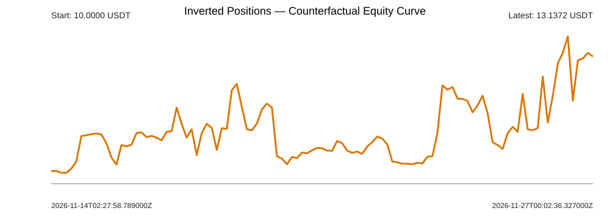

# Bitget Stocks vs Crypto — Paper Portfolio Status

> **Paper-only simulation.** No exchange orders are placed. Market data comes from Bitget public endpoints.

## At a glance

| Metric | Latest value |
|---|---:|
| Current NAV | **2.97 USDT** |
| Starting capital | 10.00 USDT |
| NAV change vs starting capital | **-7.03 USDT** |
| Portfolio ROI vs starting capital | **-70.33%** |
| Current-cycle ROI | -56.21% |
| Unrealized P&L (gross) | -3.84 USDT |
| Cumulative realized gross P&L | -2.37 USDT |
| Fees paid to date | 0.24 USDT |
| Funding posted to ledger | -0.59 USDT |
| Estimated funding pending | 0.00 USDT |
| Gross exposure | 17.15 USDT |
| Closed trades | 24 |

_NAV source: live mark-to-market observation. Values as of 2026-11-28 09:26:17 UTC._

## Latest workflow result

- **Paper runner status:** **MONITORING_ONLY**
- **Ranking data gate:** PASS
- **Monitoring operation:** MONITORING
- **Age of latest saved mark/snapshot:** 0 minutes

## Lifetime strategy performance

- **Initial capital:** 10.00 USDT
- **Current equity P&L vs initial capital:** **-7.03 USDT**
- **Lifetime portfolio ROI:** **-70.33%**
- **Equity-curve observations:** 113
- **Closed trades:** 24 | **Open trades:** 2
- **Realized net P&L on closed trades:** -3.19 USDT
- **Closed-trade win rate:** 41.67%
- **Profit factor:** 0.6486978873523304068528253677
- **Annualized Sortino ratio:** **Not yet statistically available**
- **Sortino status:** INSUFFICIENT_HISTORY: 14/20 daily returns
- **Sortino method:** consecutive UTC daily equity closes, 0% minimum acceptable return, annualized by √365; requires at least 20 valid daily returns and 5 negative days.
- **Sampled equity-curve MDD:** -70.41%

[Complete equity curve CSV](equity_curve.csv) · [Daily equity and returns](daily_equity.csv) · [Complete trade history](trade_history.csv)

### Full trade history

| Trade | Entry date | Leg | Contract | Status | Entry price | Exit price | Net P&L | Trade ROI |
|---:|---|---|---|---|---:|---:|---:|---:|
| 1 | 2026-11-14 | LONG | SOXSUSDT | CLOSED | 52.82500000 | 53.49900000 | 0.11 USDT | 1.14% |
| 2 | 2026-11-14 | SHORT | BANANAS31USDT | CLOSED | 0.00391800 | 0.00434400 | -0.86 USDT | -10.97% |
| 3 | 2026-11-15 | LONG | SKDDUSDT | CLOSED | 10.64400000 | 10.94700000 | 0.27 USDT | 2.94% |
| 4 | 2026-11-15 | SHORT | KAVAUSDT | CLOSED | 0.02938000 | 0.02945000 | -0.31 USDT | -3.41% |
| 5 | 2026-11-16 | LONG | DXYZUSDT | CLOSED | 27.72300000 | 26.60642424 | -0.38 USDT | -4.16% |
| 6 | 2026-11-16 | SHORT | SOPHUSDT | CLOSED | 0.00090900 | 0.00094800 | -0.54 USDT | -5.90% |
| 7 | 2026-11-17 | LONG | UVXYUSDT | CLOSED | 20.38900000 | 21.66700000 | 0.54 USDT | 6.64% |
| 8 | 2026-11-17 | SHORT | JCTUSDT | CLOSED | 0.00214100 | 0.00203200 | 0.42 USDT | 5.10% |
| 9 | 2026-11-18 | LONG | SHAZUSDT | CLOSED | 24.25000000 | 21.62000000 | -1.02 USDT | -11.11% |
| 10 | 2026-11-18 | SHORT | BREVUSDT | CLOSED | 0.08598000 | 0.07592000 | 0.81 USDT | 8.76% |
| 11 | 2026-11-19 | LONG | BITOUSDT | CLOSED | 16.65200000 | 15.62000000 | -0.56 USDT | -6.22% |
| 12 | 2026-11-19 | SHORT | SKYUSDT | CLOSED | 0.04017000 | 0.04365000 | -0.79 USDT | -8.75% |
| 13 | 2026-11-20 | LONG | SKDDUSDT | CLOSED | 15.15600000 | 14.32000000 | -0.40 USDT | -5.34% |
| 14 | 2026-11-20 | SHORT | AKEUSDT | CLOSED | 0.00625270 | 0.00526220 | 1.21 USDT | 15.73% |
| 15 | 2026-11-21 | LONG | CONLUSDT | CLOSED | 1.63700000 | 1.70600000 | 0.35 USDT | 4.09% |
| 16 | 2026-11-21 | SHORT | MMTUSDT | CLOSED | 0.21040000 | 0.21730000 | -0.29 USDT | -3.43% |
| 17 | 2026-11-22 | LONG | SNXXUSDT | CLOSED | 1.96800000 | 2.10200000 | 0.56 USDT | 6.52% |
| 18 | 2026-11-22 | SHORT | EVAAUSDT | CLOSED | 2.33990000 | 2.83860000 | -1.50 USDT | -21.40% |
| 19 | 2026-11-24 | LONG | NVDLUSDT | CLOSED | 16.81200000 | 14.07800000 | -1.24 USDT | -16.37% |
| 20 | 2026-11-24 | SHORT | UNITASUSDT | CLOSED | 0.18050000 | 0.19110000 | -0.45 USDT | -5.96% |
| 21 | 2026-11-25 | LONG | SOXSUSDT | CLOSED | 64.72300000 | 59.18600000 | -0.50 USDT | -8.58% |
| 22 | 2026-11-25 | SHORT | DOSUSDT | CLOSED | 0.09663000 | 0.07840000 | 1.08 USDT | 18.70% |
| 23 | 2026-11-26 | LONG | FLNCUSDT | CLOSED | 4.80600000 | 5.22500000 | 0.55 USDT | 8.59% |
| 24 | 2026-11-26 | SHORT | SKYAIUSDT | CLOSED | 0.03259000 | 0.03373000 | -0.23 USDT | -3.57% |
| 25 | 2026-11-27 | LONG | SNXXUSDT | OPEN | 1.92200000 | — | — USDT | Not available |
| 26 | 2026-11-27 | SHORT | EVAAUSDT | OPEN | 1.32240000 | — | — USDT | Not available |

Sortino remains unavailable until enough daily observations exist; no ratio is inferred from a short initial sample.

## Inverted-position alternative

- This is a retrospective counterfactual using the same selected contracts, entry/exit times and quantities with both position directions reversed.
- **Alternative equity:** **16.55 USDT** from 10.00 USDT
- **Alternative lifetime ROI:** **65.52%**
- **Alternative sampled MDD:** -17.74%
- **Observations:** 113 | **Closed legs:** 24 | **Open legs:** 2

[Inverted equity curve CSV](inverted_equity_curve.csv) · [Inverted daily equity](inverted_daily_equity.csv) · [Alternative metrics](inverted_performance_metrics.json)

- **Costs:** recorded entry/exit fees retained; posted and pending funding cashflows sign-reversed
- **Execution limitation:** Original paper fill prices and quantities are reused for both directions. Historical opposite-side order-book VWAP was not stored, so incremental bid/ask spread impact for the inverted fills cannot be reconstructed.

## Open positions

| Leg | Contract | Quantity | Entry | Latest mark | Unrealized P&L | Trade ROI |
|---|---|---:|---:|---:|---:|---:|
| LONG | SNXXUSDT | 3.530000 | 1.92200000 | 1.91000000 | -0.04 USDT | -0.74% |
| SHORT | EVAAUSDT | 5.000000 | 1.32240000 | 2.08100000 | -3.79 USDT | -57.50% |

## Risk

- **Strategy maximum drawdown:** -73.07% (observed minute history)
- **Current holding-cycle MDD:** -63.10%
- **Minute-data coverage:** 906/906 (100.00%)
- **Risk-data quality:** **COMPLETE_CURRENT_CYCLE**
- **Historical risk intervals:** 12 complete / 0 incomplete
- **Latest completed risk interval:** COMPLETE

## Cooldown safeguard

- **Cooldown flag:** **ACTIVE (1)**
- Activated: 2026-11-27 18:17:06 UTC
- Scheduled reset: 2026-11-28 18:18:00 UTC
- Current cycle start: 2026-11-27 18:17:06 UTC
- A new pair is built only when the binary flag is 0 and the ranking/depth/accounting gates pass.

## Timestamps and provenance

- **STATUS.md generated:** 2026-11-28 09:26:22 UTC
- **Paper workflow started:** 2026-11-28 09:24:35 UTC
- **Latest saved market observation:** 2026-11-28 09:26:17 UTC
- **Workflow trigger:** **schedule / paper**
- **GitHub Actions run:** [46130323264](https://github.com/takenthatusernameis-collab/CROSS-SECTIONAL-FACTOR-MOMENTUM-STOCKS-VS-MEMES-RELATIVE-PERFORMANCE-QUANTITATIVE-ALGORITHMIC-STRATS/actions/runs/46130323264)

## Interpretation notes

- NAV includes cash and mark-to-market unrealized P&L. Open-leg unrealized P&L is gross; an estimated exit fee has not yet been charged.
- Pending funding is an estimate and is not posted to the accounting ledger until the next successful rebalance.
- Without a current-pair monitor observation, marks fall back to the entry-time snapshot and are not live quotes.
- MDD is identified as unavailable until supported by minute-level observations; incomplete coverage is shown explicitly.
- This page is derived from the durable SQLite ledger after a successful paper run. The database remains the accounting source of truth.
