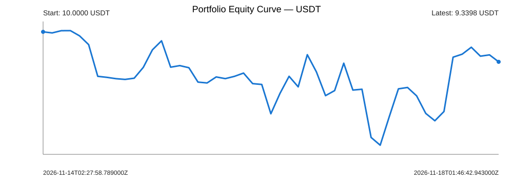

# Bitget Stocks vs Crypto — Paper Portfolio Status

> **Main-branch dashboard snapshot.** Refreshed from the durable portfolio report at the timestamp below. The authoritative live dashboard and SQLite ledger continue to update on [the durable state branch](https://github.com/takenthatusernameis-collab/CROSS-SECTIONAL-FACTOR-MOMENTUM-STOCKS-VS-MEMES-RELATIVE-PERFORMANCE-QUANTITATIVE-ALGORITHMIC-STRATS/tree/bitget-paper-portfolio-state). Open the [latest live dashboard](https://github.com/takenthatusernameis-collab/CROSS-SECTIONAL-FACTOR-MOMENTUM-STOCKS-VS-MEMES-RELATIVE-PERFORMANCE-QUANTITATIVE-ALGORITHMIC-STRATS/blob/bitget-paper-portfolio-state/STATUS.md) for the newest marks.

> **Paper-only simulation.** No exchange orders are placed. Market data comes from Bitget public endpoints.

## At a glance

| Metric | Latest value |
|---|---:|
| Current NAV | **9.02 USDT** |
| Starting capital | 10.00 USDT |
| NAV change vs starting capital | **-0.98 USDT** |
| Portfolio ROI vs starting capital | **-9.79%** |
| Current-cycle ROI | -2.18% |
| Unrealized P&L (gross) | -0.07 USDT |
| Cumulative realized gross P&L | -0.73 USDT |
| Fees paid to date | 0.03 USDT |
| Funding posted to ledger | 0.00 USDT |
| Estimated funding pending | -0.14 USDT |
| Gross exposure | 18.10 USDT |
| Closed trades | 2 |

_NAV source: live mark-to-market observation. Values as of 2026-11-15 22:02:22 UTC._

## Latest workflow result

- **Paper runner status:** **MONITORING_ONLY**
- **Ranking data gate:** PASS
- **Monitoring operation:** MONITORING
- **Age of latest saved mark/snapshot:** 0 minutes

## Lifetime strategy performance

- **Initial capital:** 10.00 USDT
- **Current equity P&L vs initial capital:** **-0.98 USDT**
- **Lifetime portfolio ROI:** **-9.79%**
- **Equity-curve observations:** 28
- **Closed trades:** 2 | **Open trades:** 2
- **Realized net P&L on closed trades:** -0.75 USDT
- **Closed-trade win rate:** 50.00%
- **Profit factor:** 0.1259047117265244274614615759
- **Annualized Sortino ratio:** **Not yet statistically available**
- **Sortino status:** INSUFFICIENT_HISTORY: 1/20 daily returns
- **Sortino method:** consecutive UTC daily equity closes, 0% minimum acceptable return, annualized by √365; requires at least 20 valid daily returns and 5 negative days.
- **Sampled equity-curve MDD:** -18.25%

[Complete equity curve CSV](https://github.com/takenthatusernameis-collab/CROSS-SECTIONAL-FACTOR-MOMENTUM-STOCKS-VS-MEMES-RELATIVE-PERFORMANCE-QUANTITATIVE-ALGORITHMIC-STRATS/blob/bitget-paper-portfolio-state/equity_curve.csv) · [Daily equity and returns](https://github.com/takenthatusernameis-collab/CROSS-SECTIONAL-FACTOR-MOMENTUM-STOCKS-VS-MEMES-RELATIVE-PERFORMANCE-QUANTITATIVE-ALGORITHMIC-STRATS/blob/bitget-paper-portfolio-state/daily_equity.csv) · [Complete trade history](https://github.com/takenthatusernameis-collab/CROSS-SECTIONAL-FACTOR-MOMENTUM-STOCKS-VS-MEMES-RELATIVE-PERFORMANCE-QUANTITATIVE-ALGORITHMIC-STRATS/blob/bitget-paper-portfolio-state/trade_history.csv)

### Full trade history

| Trade | Entry date | Leg | Contract | Status | Entry price | Exit price | Net P&L | Trade ROI |
|---:|---|---|---|---|---:|---:|---:|---:|
| 1 | 2026-11-14 | LONG | SOXSUSDT | CLOSED | 52.82500000 | 53.49900000 | 0.11 USDT | 1.14% |
| 2 | 2026-11-14 | SHORT | BANANAS31USDT | CLOSED | 0.00391800 | 0.00434400 | -0.86 USDT | -10.97% |
| 3 | 2026-11-15 | LONG | SKDDUSDT | OPEN | 10.64400000 | — | — USDT | Not available |
| 4 | 2026-11-15 | SHORT | KAVAUSDT | OPEN | 0.02938000 | — | — USDT | Not available |

Sortino remains unavailable until enough daily observations exist; no ratio is inferred from a short initial sample.

## Open positions

| Leg | Contract | Quantity | Entry | Latest mark | Unrealized P&L | Trade ROI |
|---|---|---:|---:|---:|---:|---:|
| LONG | SKDDUSDT | 0.860000 | 10.64400000 | 10.43400000 | -0.18 USDT | -2.09% |
| SHORT | KAVAUSDT | 314.400000 | 0.02938000 | 0.02904000 | 0.11 USDT | -0.51% |

## Risk

- **Strategy maximum drawdown:** -38.45% (observed minute history)
- **Current holding-cycle MDD:** -35.25%
- **Minute-data coverage:** 1136/1136 (100.00%)
- **Risk-data quality:** **COMPLETE_CURRENT_CYCLE**
- **Historical risk intervals:** 1 complete / 0 incomplete
- **Latest completed risk interval:** COMPLETE

## Cooldown safeguard

- **Cooldown flag:** **ACTIVE (1)**
- Activated: 2026-11-15 03:04:16 UTC
- Scheduled reset: 2026-11-16 03:05:00 UTC
- Current cycle start: 2026-11-15 03:04:16 UTC
- A new pair is built only when the binary flag is 0 and the ranking/depth/accounting gates pass.

## Timestamps and provenance

- **STATUS.md generated:** 2026-11-15 22:02:29 UTC
- **Paper workflow started:** 2026-11-15 22:01:47 UTC
- **Latest saved market observation:** 2026-11-15 22:02:22 UTC
- **Workflow trigger:** **schedule / paper**
- **GitHub Actions run:** [43766925114](https://github.com/takenthatusernameis-collab/CROSS-SECTIONAL-FACTOR-MOMENTUM-STOCKS-VS-MEMES-RELATIVE-PERFORMANCE-QUANTITATIVE-ALGORITHMIC-STRATS/actions/runs/43766925114)

## Interpretation notes

- NAV includes cash and mark-to-market unrealized P&L. Open-leg unrealized P&L is gross; an estimated exit fee has not yet been charged.
- Pending funding is an estimate and is not posted to the accounting ledger until the next successful rebalance.
- Without a current-pair monitor observation, marks fall back to the entry-time snapshot and are not live quotes.
- MDD is identified as unavailable until supported by minute-level observations; incomplete coverage is shown explicitly.
- This page is derived from the durable SQLite ledger after a successful paper run. The database remains the accounting source of truth.
